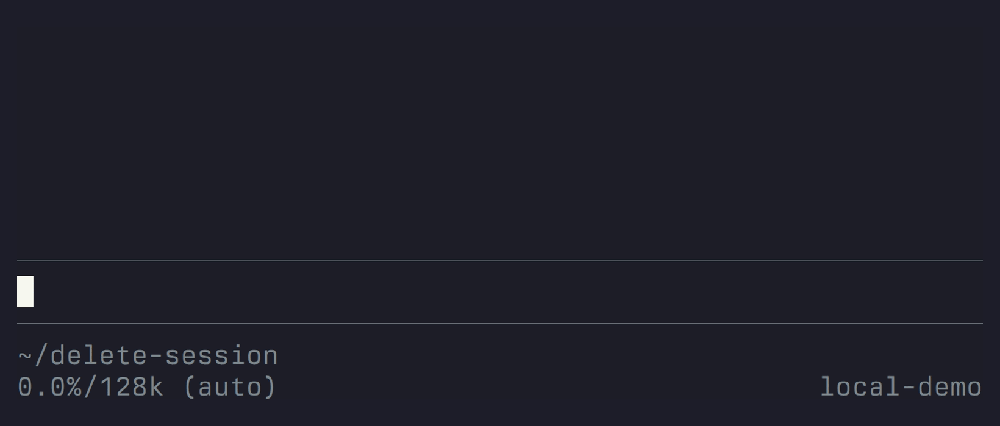

# Delete Session

Run `/delete`. In the interactive UI, **Yes, delete it** is selected first. Press Enter to confirm or Esc to cancel. Without a UI there is no confirmation prompt. The command starts a fresh session before removing the previous session file. Cancelling the session switch keeps the file.



## Install

```bash
pi install npm:@karlis-vagalis/pi-delete-session
```

Run `/reload` in an existing Pi session.
