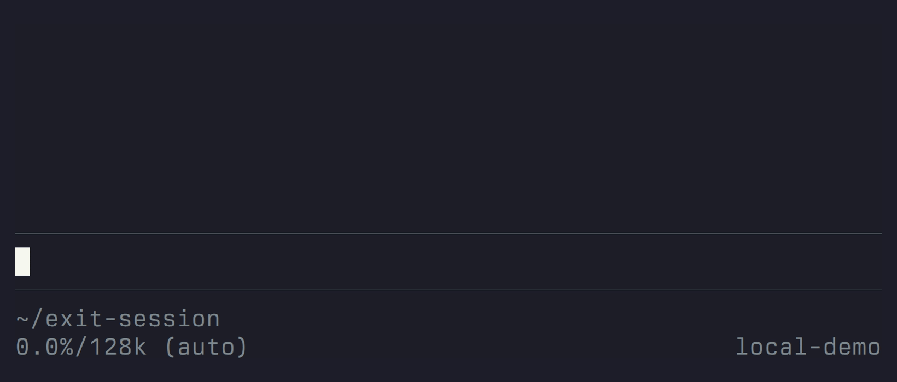

# Exit Session

Run `/exit`, or type `exit` as a message on its own. Plain-text input ignores capitalization and surrounding whitespace.



## Install

```bash
pi install npm:@karlis-vagalis/pi-exit-session
```

Run `/reload` in an existing Pi session.
