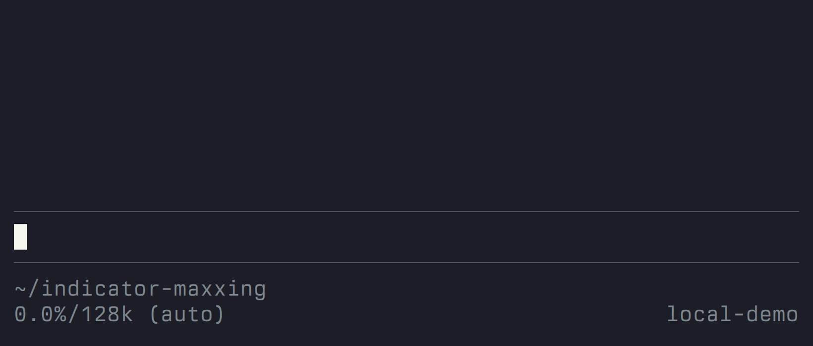

# Indicator Maxxing

Each turn pairs a random working message with an animated spinner in your Pi theme’s accent color. Run `/spinner` to choose a different animation. Pi remembers your choice between sessions; the default is `sparkle`.



## Install

```bash
pi install npm:@karlis-vagalis/pi-indicator-maxxing
```

Run `/reload` in an existing Pi session.
