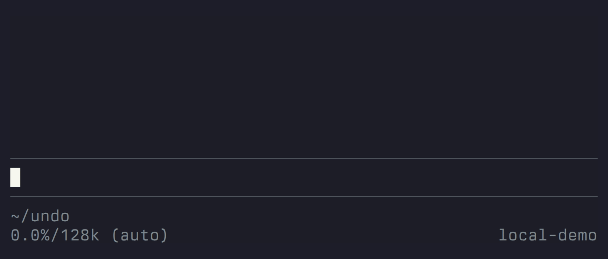

# Undo

Run `/undo` while Pi is idle to return to the point before your last message on the current branch. Edit the restored prompt and submit it again. This changes the conversation, not files on disk.



## Install

```bash
pi install npm:@karlis-vagalis/pi-undo
```

Run `/reload` in an existing Pi session.
