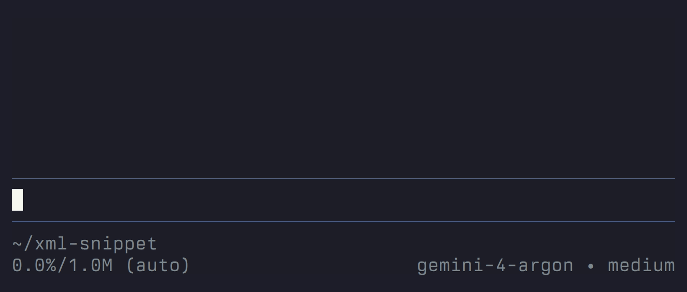

# XML Snippet

Type `<context` and press Tab to accept the completion. Pi inserts `<context>` and `</context>` on separate lines and places the cursor on the blank line between them.



## Install

```bash
pi install npm:@karlis-vagalis/pi-xml-snippet
```

Run `/reload` in an existing Pi session.
